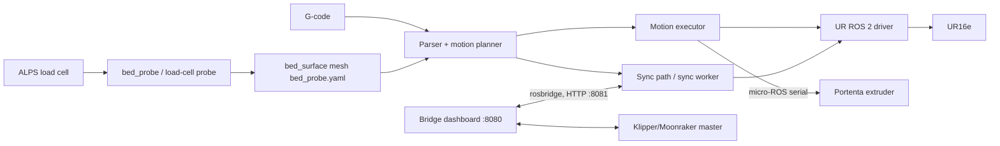

# Architecture

## Packages (`src/`)

- `print_control` – parser, planner (IK via the custom UR16e DH model),
  `bed_surface`, executor, probing (`bed_probe`, `load_cell_bed_probe`,
  `bridge_bed_probe`, `load_cell_contact`), `alps_load_calibration`,
  `sync_path`/`sync_runtime`/`sync_clock` (Klipper-timed execution),
  `robot_ownership` (single-owner lock), `probe_control`, TCP configuration.
- `extrusion_control` – serial bridge to the Portenta extruder.
- `axisforge_bringup` – launch files and YAML (`ur_master.yaml`,
  `bed_probe.yaml`, `load_cell_bed_probe.yaml`, `bridge_bed_probe.yaml`,
  `alps_load_calibration.yaml`).
- `models/ur16e` – custom UR16e kinematics (installed by `scripts/install_ur_models.sh`).
- `docker/` – container entrypoints (`bridge.sh`, `sync-worker.sh`, `robot-connection.sh`).

## Modes

1. **Standalone:** AxisForge plans and executes G-code and extrusion itself.
2. **Klipper master / robot follower:** Klipper owns timing and E; the sync
   worker replays a timed joint trajectory at the mapped master time and never
   publishes extrusion commands. Both modes share the robot ownership lock so
   only one controller can move the arm.

## Frames

Bed surface is a probed 3x3 mesh transform; nozzle TCP offset is configured in
`ur_master.yaml` and editable from the dashboard (**Setup & calibration**).
